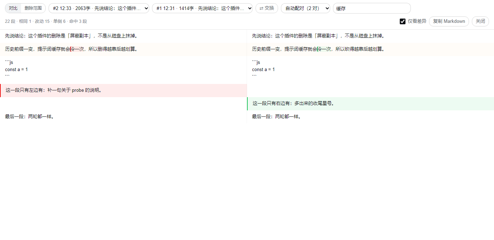

# dsh-scalpel

DeepSeek Harness 的**上下文手术刀**。只做两件事：

1. **同会话对比** —— 同一个会话里前后两次回答，并排看，段落级对齐 + 词级高亮。
2. **同会话剔除** —— 把指定的若干**轮**从之后每一次发给模型的请求里摘掉；会话文件、界面、别人的视角都不动。

[](LICENSE)


---

## 效果



> 这张图是"第 1 轮 vs 第 2 轮"的离线渲染（同一套 `lib/compare-core.js`），深色两列、段落对齐、改动段词级高亮。插件内的面板用的是同一套布局。

## 为什么要"剔除"而不是"删除"

会话是 append-only 的事件日志。历史一旦落盘就不可改，任何"删消息"在 DSH 里都只能作用在**发给模型的那份副本**上：

- 本插件挂在宿主的 `agent/pre-step`，在这一轮 `messages` 组装完成、发出去之前改写它；
- 规则按 `sessionId + 轮号区间` 存在 `~/.dsh/scalpel-drop.json`，每轮重读，改规则**不用重启**；
- 每轮摘了几条、省了多少字符，写进 `~/.dsh/scalpel-audit.jsonl`。

代价（是设计选择，不是 bug）：

| 现象 | 原因 |
| --- | --- |
| 界面和会话记录仍是原样 | 只改请求副本，真相源不碰 |
| 前缀一变，prompt cache 冷一次 | 上下文前段被改写，缓存键必然变 |
| 只能按**整轮**切，不能拆单条消息 | 保证 `tool_use` / `tool_result` 永远成对，不会 400 |
| 永远不剔除当前正在回答的那一轮 | 否则模型无话可接 |

## 安装

发布到 npm 后：

```sh
dsh plugin --profile desktop add dsh-scalpel
# 把 dsh.profile.bundles 里加上 "dsh-scalpel"，然后完全退出 DSH 再启动
```

本地开发（仓库就在本机）：

```sh
# 1) 把仓库链进 profile 的 node_modules
mklink /J "%USERPROFILE%\.dsh\profiles\desktop\node_modules\dsh-scalpel" "F:\centos\dsh-scalpel"

# 2) profile 的 package.json：dependencies 加 "dsh-scalpel": "link:../../local-plugins/dsh-scalpel"
#    并把 "dsh-scalpel" 写进 dsh.profile.bundles

# 3) 完全退出 DSH 再启动（bundle 是开机捕获的，刷新页面不生效）
```

> `~/.dsh/local-plugins/<name>/` **不会被自动扫描**，文件夹存在 ≠ 加载。必须走 profile 的依赖 + bundles 清单。

## 用法：对比

三个入口，同一套对齐算法：

| 入口 | 位置 | 适合 |
| --- | --- | --- |
| 顶部 **对比** tab | 会话视图切换栏 | 长时间并排看 |
| 每条回答的 **⚖ 对比** | assistant 消息动作行 | 从某条回答直接开面板 |
| `scalpel compare` | 终端 | 脚本、分享、`code --diff` |

面板里：左边选一条回答、右边选一条，`⇄` 交换，`仅看差异` 关掉相同段。统计行给的是 `总段数 · 相同 · 改动 · 单侧`。

命令行：

```sh
scalpel sessions --limit 5                 # 最近的会话
scalpel turns latest                        # 这个会话有几轮
scalpel compare latest --a 1 --b 2          # 第 1 轮 vs 第 2 轮
scalpel compare latest --a 1 --b 2 --json   # 结构化输出，给别的工具吃
```

`<session>` 可以是**会话 id 前缀**、**文件路径**，或 `latest`。

## 用法：剔除

```sh
scalpel drop latest --from 5 --to 7 --dry   # 先看图什么会被摘掉（只写审计）
scalpel drop latest --from 5 --to 7         # 真摘
scalpel undrop latest                       # 全撤
scalpel rules                               # 当前规则
scalpel audit --limit 20                    # 每轮摘了几条
```

规则文件长这样：

```jsonc
{
  "version": 1,
  "sessions": {
    "<sessionId>": {
      "dropTurns": [[5, 7]],   // 剔除第 5~7 轮；轮 = 一条用户消息开始的一段
      "dryRun": false          // true 时只写审计，不动 messages
    }
  }
}
```

## CLI 全部命令

```
scalpel sessions [--limit N]
scalpel turns <session|latest> [--json]
scalpel compare <session|latest> --a N --b M [--json]
scalpel drop <session|latest> --from N [--to M] [--dry]
scalpel undrop <session|latest> [--all]
scalpel rules
scalpel audit [--limit N]
scalpel doctor          # 装了但没生效时先用它
scalpel --version | --help
```

会话数据来自 `~/.dsh/sessions/<workspace>/session-<uuid>/session.v4.jsonl.zstd`（多帧 zstd，按 magic `28 B5 2F FD` 切帧解压，Node 22 内置 `zstdDecompressSync` 直接读，无第三方依赖）。

**大会话怎么读的**：逐帧解压、逐行解析，读完即弃；只留 12 类事件（`turn/start` `turn/end` `step/start` `step/end` `user/message` `assistant/message` `tool/call` `tool/result` `session` `session/title` `model/selection` `request/context`），工具入参截到 400 字、工具返回只留 callId、流式增量与每轮重复的完整工具表直接丢掉。本机实测：14.7 MB 的会话解出来峰值内存 ~101 MB、1 秒（不瘦身会是几百 MB，一次多读几个就 OOM）。

## 装了但没生效？

```
scalpel doctor
```

一次列出：Node 有没有 zstd、`exports["./client"]` 在不在、`dsh.client` 的 `platform/immediately` 对不对、`dsh.bundle.patch` 指的文件在不在、宿主半能不能 import、profile 里**依赖**和 **`dsh.profile.bundles`** 两处都写了没、`node_modules/dsh-scalpel` 的 realpath 是不是这一份、规则文件能不能解析、审计日志可写、探针多久没更新（探针是宿主半第一次跑 pre-step 时写的，没写说明它没被加载）。全部只读，有 fail 时退出码 1。

两个最常见的坑它直接点出来：**只加了依赖没加 `dsh.profile.bundles`**（宿主不加载，不报错）和 **bundle 是开机捕获的**（改完只刷新页面没用，探针时间戳会暴露这一点）。

## 什么时候**别**用它

- 想让模型"以后再也不提 B" —— 剔除只是让它看不见，你自己的会话里 B 还在。要彻底干净，请开新会话 + 交接稿。
- 想物理删除某段历史 —— 别直接改 `session.v4.jsonl.zstd`，会破坏 replay。真要删就整会话归档。

## 文件

| 文件 | 作用 |
| --- | --- |
| `lib/index.js` | 宿主半：pre-step 过滤、规则读写、审计、首轮探针 |
| `lib/compare-core.js` | 纯函数对比核心（分块 / LCS 对齐 / 词级 diff），宿主与浏览器共用 |
| `lib/session.js` | 会话文件解码与轮次提取 |
| `client.js` | 客户端半：对比 tab、⚖ 按钮、对比面板 |
| `bin/scalpel.mjs` | CLI |
| `cordis.patch.yml` | 挂载入口 |

## 开发

无构建步骤：纯 ESM，`client.js` 是手写 bundle（不走 tsdown/tsc，`window.__ModuleLoader__` 包装）。

```sh
node --check client.js
node --check bin/scalpel.mjs
node bin/scalpel.mjs rules
```

## Roadmap

- 自动配对：同一问题问了两遍，自动把两次回答配成一对
- 话题分段：长会话按话题切开，可整段屏蔽
- 面板内的 dry-run 预览与一键撤销
- `/compare` `/drop` 两个会话内命令

## License

MIT